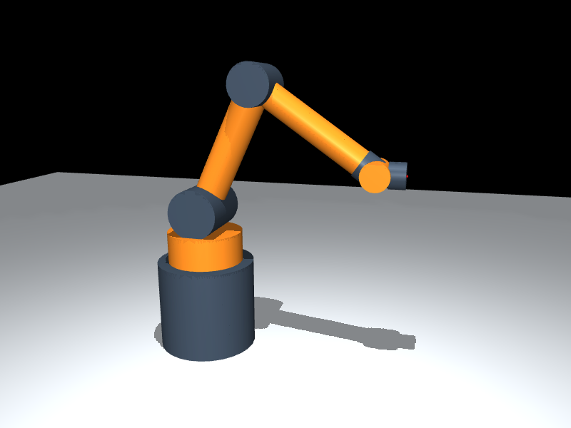

# 已核准六軸圓柱手臂：正式接入

正式模型為 [six_axis_arm.xml](../../../assets/six_axis_arm.xml)。九個圓柱的形狀、位置、顏色與 [核准原型](../../designs/six_axis_arm/prototype-v1/README.md) 相同；兩根長臂配緊湊三軸手腕，不再使用三組交替 yaw/pitch 階梯構型。

這是 MuJoCo 3.10.0 的 **llvmpipe CPU render**，800 × 600；不是示意圖。從正式模型 `home` keyframe 重置，姿態為 `[0,65,-100,0,35,0]°`。相機與 viewer 啟動值相同；圖片與核准預覽逐 byte 相同。參數、重力需求與腕部間隙見 [metadata.json](metadata.json)，短重生腳本為 [inspect_model.py](inspect_model.py)。

## 模型與操作

| 軸 | 分工 | 限位 | 馬達最大力矩 |
|---|---|---|---|
| J1 | 底座 yaw | ±180° | 12 Nm |
| J2 | 肩 pitch | −100～130° | 20 Nm |
| J3 | 肘 pitch | ±145° | 12 Nm |
| J4 | 腕 roll | ±180° | 3 Nm |
| J5 | 腕 pitch | ±45° | 3 Nm |
| J6 | 工具 roll | ±180° | 2 Nm |

密度 1000 kg/m³、線性關節阻尼 0.1 N·m·s/rad、步長 0.002 s 與馬達額定是明示的教學假設，沒有硬體校正依據。所有模式共用模型額定，沒有姿態模式專用加力。home 肩／肘重力需求為 4.857／1.851 Nm；全零直伸為 9.364／2.252 Nm。控制器沿用質量矩陣縮放 PD、bias/passive 與本模型線性 Euler 阻尼補償；目標參考速度上限 30°/s，實際速度在受力／碰撞時不保證硬性小於此值。

J5 原型 ±120° 是未驗證提案參數。正式模型收為 ±45°：腕 roll 圓柱與工具法蘭於正負 45° 都有 2.373 mm 間隙；±50° 僅 0.487 mm，±52° 已穿透 0.216 mm 並有接觸。這是腕部自身固定掃掠限制，不改核准外觀或 home 的 35°。未關閉碰撞或加入 pair 排除；相鄰圓柱在接頭有教學簡化重疊，非相鄰與地面碰撞仍保留。

執行 repo 根目錄的 `run.bat`。F1–F6 選關節，左右鍵 ±5°、Shift+左右鍵 ±1°；P 捕捉目前姿態，Home 平順回展示姿態，Backspace 重置時間與模擬回展示姿態，Space 暫停，1/2/3 為依新軸分組的定力矩示範。J6 的圓柱旋轉對稱，角度／工具方向改變不一定有可見輪廓變化；可看 HUD。

## 驗證與界線

Windows `cmd /c build.bat` 成功（最多兩個建置程序），CTest 單程序 **3/3 通過**，原始輸出見 [ctest.log](ctest.log)，對應來源雜湊見 [validation.json](validation.json)。

- `six_axis_arm_model`：實際載入正式模型及原型，核對九圓柱、body chain、六軸／motor、限幅旗標、home 弧度與 J6 方向變化。除有幾何依據的 J5 限位外，保留提案關節行程。
- `controller_pose`：home 保持、J5 45°、兩組肩肘／腕目標追蹤及保持、P 捕捉、全零 API、Home 回展示姿態、重置、拒絕非有限輸入、限位／限幅、三種定力矩分組與真接觸受阻時有限數值。收斂 gate 保留誤差 <0.5°、速度 <1°/s；home/reset <0.25°。輸出顯示 0.000000 是六位小數顯示精度，不是數學零誤差。
- `arm_geometry`：home、兩組混合姿態、J5 45°與全零，共 5 個樣本 engine contacts 為 0，非相鄰 geom 最小間隙 2.373 mm。向下姿態 `[0,-60,0,0,0,0]°` 實際碰底座／地面（瞬時 21 contacts），不要求它收斂。
- 負例：臨時把工具法蘭半徑 .028 改 .060 m，外形對照測試如預期失敗；另把上臂半徑 .035 改 .40 m，幾何測試如預期偵測非相鄰／地面穿透並回傳非零。壞模型只放 ignored build 目錄，未替換正式模型。

這些是有限樣本與短模擬，不能證明所有關節組合無碰撞或在所有負載下可達。GUI 鍵盤、滑鼠與 Windows 視窗實際體驗尚未操作驗收，見 [WAIT_USER](../../../wf/WAIT_USER.md)。
